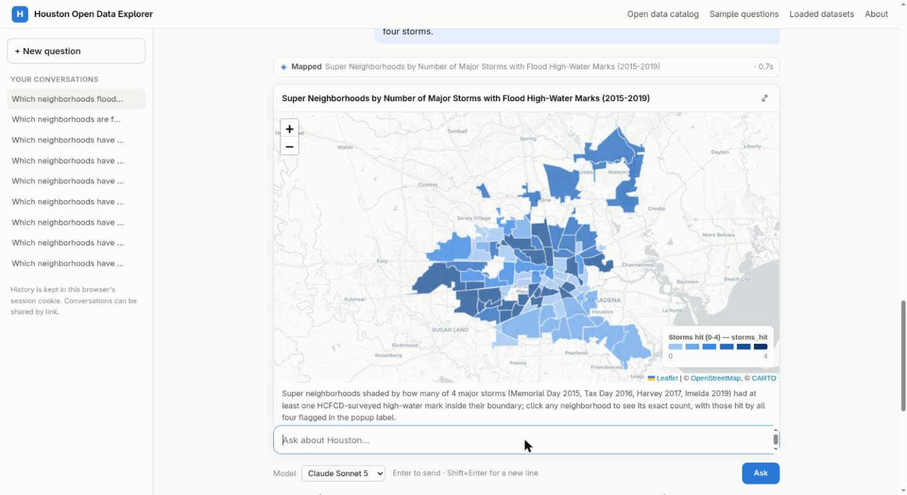

# Houston Open Data Explorer: One Open Data Server to Rule Them All

**Houston's open data is scattered across 16 sources and 7,218 datasets. The Houston Open Data Explorer puts the useful part in one
fast GIS database, catalogs the rest, and lets anyone ask questions in plain English.**

- **Live site (currently):** https://fasthouston.org (ask a question) · https://fasthouston.org/catalog (browse every source)
- **Video demo:** https://youtu.be/JUjtuSwiVpk
- Built for the [Houston Hackathon 2026](https://houstonhackathon2026.devpost.com).

## The story: the project changed course halfway through

The plan was small: load about 15 interesting City of Houston map layers (storm drains, high-water marks, crime,
fire stations) and put an AI chat on top to answer questions that cross them.

But every question turned up another useful dataset, often on an ArcGIS server I didn't know existed. So I kept
asking, "what else is on *that* server?" The list grew from the City's two GIS hubs to Harris County, the Flood
Control District, Rice University, HARC, and federal feeds, until there were thousands of candidate layers.

So I asked a different question: **how much data would it take to just load all of it?**

**Not much.** Every layer of real interest came to:

| | |
|---|---:|
| Layers and datasets loaded | **150** |
| Rows | **~8.5 million** |
| Database size (with indexes) | **9.4 GB** |
| Total download time | **< 30 minutes** |

That meant I no longer had to guess in advance which data might be useful. Everything of interest is in one
PostGIS database, and everything else is listed in a searchable catalog.

## The census of Houston's open data

| Source | Items | Loaded |
|---|---:|---:|
| Harris County ArcGIS Online | 3,112 | 16 |
| Rice University ArcGIS Online | 2,888 | 0 |
| HARC ArcGIS Online | 528 | 1 |
| City of Houston GIS (two ArcGIS Hubs) | 314 | 119 |
| Harris County Flood Control District ArcGIS Online | 265 | 4 |
| City of Houston Open Data (data.houstontx.gov) | 94 | 0 |
| Federal, state and transit (Census, FEMA, CDC, EPA, USGS, TxDOT, TCEQ, METRO, 311, Stanford) | 17 | 10 |
| **Total** | **7,218** | **150** |

The City layers that weren't loaded are mostly parcel duplicates, bulk utility networks and detention-pond geometry.
Most County and Rice items are staff working copies or class projects, with real gems among them.

In this repo:

- [`catalog/SOURCES.md`](catalog/SOURCES.md): every source, what it holds, and datasets worth adding next.
- [`catalog/all_datasets.csv`](catalog/all_datasets.csv): all 7,218 items, with type, geometry, record count,
  status (loaded, candidate, not loaded, needs permission) and link.
- [`catalog/loaded_datasets.csv`](catalog/loaded_datasets.csv): the 146 datasets the AI analyst can query, in 14
  categories, with row counts.

## Ask it anything

Type a question in plain English. The AI analyst picks the datasets, queries the database, and answers with
numbers, a table, a chart or a map. It shows every step, a one-line method, and the caveats that apply.

**Example:** *"Which neighborhoods flooded in three or more of the four big storms (Memorial Day 2015, Tax Day
2016, Harvey, Imelda)?"*

> 40 super neighborhoods had high-water marks recorded in 3 or more of the four storms, and 23 of those were hit
> in all four, including Alief, Braeswood, Greater Heights, Meyerland, Near Northside and Sharpstown.
>
> **Method:** joined the Flood Control District's surveyed high-water marks (92, 295, 574 and 203 points) to the
> 88 super neighborhoods, and counted the storms that left at least one mark inside each.
>
> **Caveat:** high-water marks are survey points along bayous and bridges, not full flood maps.

The answer took 25 seconds and cost $0.08. [Screenshot](images/flood_answer.jpg).

More findings: [`analyses/ANALYSES.md`](analyses/ANALYSES.md).

## Trust

- **Shows its work:** every query, a method line and caveats come with each answer.
- **Read-only:** the AI's database access can only read, with a time limit on each query.
- **Provenance:** every row traces back to its source layer and the run that loaded it.
- **Model comparison:** the same question can run on 15 AI models from several providers.

## What's next

- Load the next tier: City checkbook, payroll and budget; Flood Control buyout areas; live county air sensors;
  METRO service frequency; 1930s redlining maps.
- Refresh every loaded layer nightly.
- The same approach for a city's internal data, on hardware the city controls.
- Other cities: nothing here is Houston-specific except the source list.

Part of a Houston flood toolkit: **Know it** (fasthouston.org), **See it** (Flood AR:
[demo](https://youtu.be/eTixT4tzWrQ)), **Act on it** (floodroutes: https://floodroutes.nbolt.com).

## About this repo

This repo publishes the catalog, statistics and analyses. The software behind fasthouston.org (the data pipeline
and the web app) is not open source. For inquiries, contact A. Lester Buck III.

The catalog and write-ups are licensed [CC BY 4.0](LICENSE). The underlying datasets belong to their publishers
and are subject to their terms.
