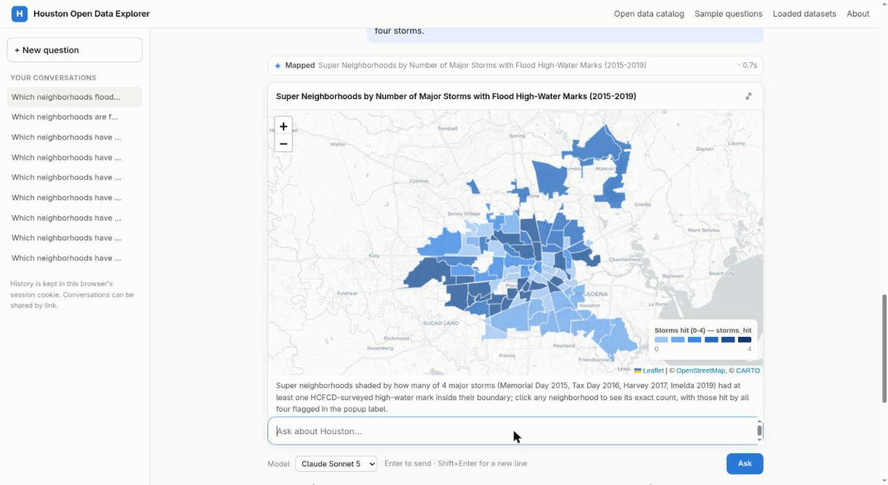

# Findings

Questions answered from Houston's public data. Each one joins datasets that are published in different places.

## Which neighborhoods flooded in three or more of the four big storms?

Flood Control District high-water marks (Memorial Day 2015, Tax Day 2016, Harvey 2017, Imelda 2019) × City super
neighborhoods.

- **All four storms (23):** Alief, Astrodome Area, Braeburn, Braeswood, Central Northwest, Denver Harbor/Port
  Houston, Eldridge/West Oaks, Greater Heights, Gulfgate Riverview/Pine Valley, Langwood, Lawndale/Wayside,
  MacGregor, Medical Center Area, Meyerland Area, Near Northside, Near Southwest, Northshore, Northside/Northline,
  Sharpstown, University Place, Westbury, Westchase, Westwood.
- **Three of four (17 more):** Brays Oaks, Eastex-Jensen Area, East Houston, East Little York/Homestead, El
  Dorado/Oates Prairie, Greater Greenspoint, Hidden Valley, IAH/Airport Area, Independence Heights, Kashmere
  Gardens, Kingwood Area, Lake Houston, Lazybrook/Timbergrove, Memorial, Spring Branch Central, Trinity/Houston
  Gardens, Willowbrook.
- The four-storm neighborhoods form corridors along Brays Bayou and through the Near Northside.
- **Caveat:** 1,164 high-water marks are survey points along channels and bridges, not full flood maps. A
  neighborhood with no mark may still have had street flooding.

## When do aggravated assaults peak, and does Alief differ from Sharpstown?

HPD NIBRS crime data 2020–2024, class 13A (Alief n=3,612, Sharpstown n=3,284).

| | Midnight–6 AM | 6 AM–noon | Noon–6 PM | 6 PM–midnight |
|---|---:|---:|---:|---:|
| Citywide | 22.0% | 15.8% | 27.2% | 35.1% |
| Alief | 21.7% | 14.5% | 27.5% | 36.4% |
| Sharpstown | 27.6% | 14.6% | 22.2% | 35.6% |

- Both neighborhoods peak at 10 PM, the same as the city.
- Sharpstown has more late-night assaults than the city in all five years. Alief follows the city's pattern.
  A chi-square test says the difference is real (p < 0.0001).
- **Lesson:** 2024 data alone suggested the opposite, that Alief was the late-night neighborhood. Loading five
  years reversed that conclusion.

## Which neighborhoods are far from a fire station and have many fires?

Structural fires 2015–2021 × 90 HFD fire stations (4 airport-rescue stations excluded), straight-line distance.

- Across 88 neighborhoods, distance to the nearest station is unrelated to total fires (rank correlation 0.02).
- Far and fire-heavy: Greater Inwood, Fort Bend Houston, **Gulfton**, Sunnyside, East Little York/Homestead,
  Westwood, Acres Home, Northside/Northline, Alief.
- **Gulfton** has the highest fire density in the city (18.8 per km²) and no station inside its boundary. Its fires
  average 1.88 km from the nearest station (farthest 2.84 km); Stations 51 and 28 are nearest for all of them.
- **Caveats:** straight-line distance understates real drive distance across US-59 and the Westpark Tollway. The
  fire rate likely reflects old, dense apartment stock as much as station placement: several addresses had 5 or 6
  fires each.

Interactive map: [`gulfton_fire_reach.html`](gulfton_fire_reach.html) (download and open in a browser).
